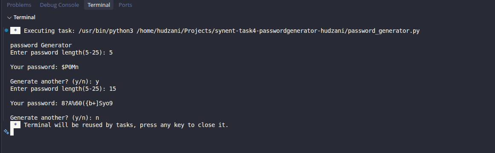

# Password Generator (CLI)

Synent Technologies Python Internship, task 4.

    A command line tool that generates strong random passwords.

**Features**

    - Choose a password length from 5 to 25 characters
     - Every password contains uppercase letters, lowercase      letters,numbers and special characters
     - Handles invalid input (letters, numbers out of range)
     - Option to generate several passwords in one session

**How to run**

     python3 password_generator.py

**Example output**

    Password Generator
    Enter password length (5-25) : 6

    Your password: k#7Qm!
    Generate another? (y/n): n

**Methodology**

     1. Use 'random.SystemRandom', which draws from the operating system's secure random source, so passwords are hard to predict.
     2. Ask for a length and validate it with 'try/except' and a range check.
     3. Define four character pools: uppercase, lowercase,digits and special characters.
     4. Pick one character from each pool so every type is always  included.
     5. Fill the remaining length with random characters from all pools combined.
     6. Shuffle the characters so the guaranteed ones are not always in the same positions.

**Screenshots**
    

**Author**
Hudzani